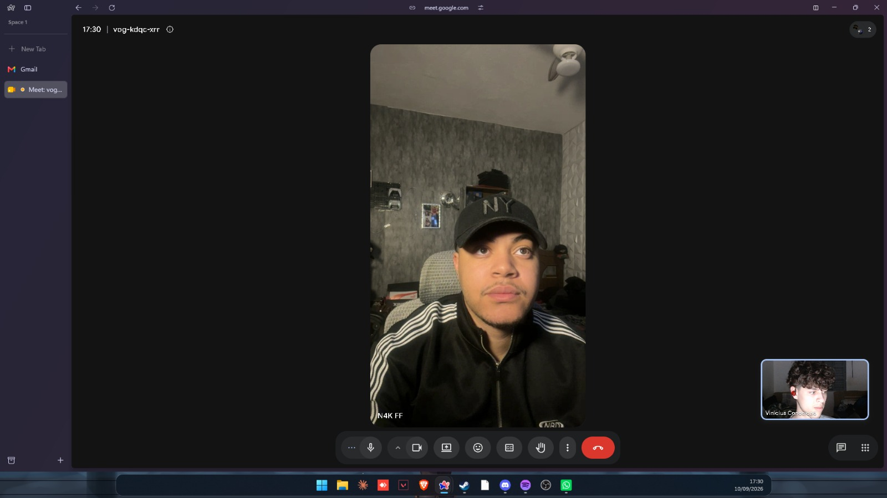

# UsantoosFps — site institucional

Site de otimização remota de PC para jogos. Next.js 15 + Tailwind CSS v4,
App Router, 15 rotas, dark mode nativo e conteúdo centralizado em um arquivo só.


## 1. Integrantes do grupo

| Nome completo | RGM | Usuário GitHub |
|---|---|---|
| [Eduardo Silva Morishita] | [48501883 ] | [https://github.com/EduMoridev] |
| [Vinicius Santos Conceição] | [47451530 ] | [https://github.com/VinnySantosDev] |
| [Bruna Soares De Almeida] | [47552158 ] | [https://github.com/BrunaAlmeida01] |
| [Vinicius Henrique Silva Ferreira] | [47449438 ] | [https://github.com/VinnyzScript] |
| [Jorge Gabriel Cordeiro do Nascimento] | [48097501 ] | [https://github.com/EGROJ-dev] |

---


## 3. Introdução

A UsantossFps é uma organização que presta serviço de otimização remota de
computadores para jogos: ajustes de sistema operacional, drivers, BIOS e rede
para aumentar FPS e reduzir latência, sem necessidade de troca de hardware.
Esta Entrega 1 corresponde à fundação em HTML do site institucional da
organização, ainda sem estilização visual (CSS será adicionado na Entrega 2).

---

## 4. Contato com o responsável

**Formato da entrevista:** [Google Meet]
**Data:** [10/09/2026]
**Responsável entrevistado:** [ Nycolas Santos Marcelino / CEO|Dono ]

**Comprovação:**



---

## Rodar

```bash
npm install
npm run dev            # http://localhost:3000
```

Build de produção:

```bash
npm run build
npm start
```

Site estático (Netlify, Vercel, GitHub Pages, hospedagem comum) — gera `./out`:

```bash
STATIC_EXPORT=1 npm run build
```

---

## Estrutura

```
src/
  app/                 rotas (App Router)
    page.tsx                     Home
    sobre/                       Quem faz
    servicos/                    Lista de serviços
    servicos/[slug]/             Template de serviço individual
    planos/                      Planos e preços
    resultados/                  Antes e depois (cases com métricas)
    depoimentos/                 Prova social
    como-funciona/               Processo em 5 etapas
    faq/                         Perguntas frequentes
    blog/  blog/[slug]/          Blog técnico
    contato/                     Formulário + agenda
    legal/privacidade/           LGPD
    legal/termos/                Termos de uso
    style-guide/                 Design system vivo
    globals.css                  Tokens de design (bloco @theme)
  components/          biblioteca de UI reutilizável
  lib/site.ts          TODO o conteúdo do site
docs/
  DESIGN-SYSTEM.md             Guia de estilo + justificativa das escolhas
  COMO-IMPORTAR-NO-FIGMA.md    Passo a passo do arquivo Figma
  framelab-tokens.json         Tokens para o plugin Tokens Studio
  prototipo.html               Protótipo navegável em arquivo único
```

---

## Onde mexer

| O que | Onde |
|---|---|
| Nome da marca, tagline, CNPJ | `src/lib/site.ts` → `BRAND` |
| WhatsApp, Discord, e-mail, horários | `src/lib/site.ts` → `CONTACT` |
| Serviços, preços, o que está incluso | `src/lib/site.ts` → `SERVICES` |
| Planos e tabela comparativa | `src/lib/site.ts` → `PLANS` |
| Cases com métricas antes/depois | `src/lib/site.ts` → `CASES` |
| Depoimentos | `src/lib/site.ts` → `TESTIMONIALS` |
| FAQ | `src/lib/site.ts` → `FAQ_CATEGORIES` |
| Artigos do blog | `src/lib/site.ts` → `POSTS` |
| Cores, fontes, espaçamentos | `src/app/globals.css` → `@theme` |

Trocar um preço ou um telefone é uma linha e reflete em todas as páginas.

---

## Design system

Base escura neutra (zinc/stone) + **um único acento**: verde `#22C55E`, limitado a
ação (CTA, estado ativo) e dado (número-chave, série "depois" dos gráficos).
Tipografia: Space Grotesk nos títulos, Inter no corpo, mono nos rótulos e números.
Detalhes e justificativas em `docs/DESIGN-SYSTEM.md` e na rota `/style-guide`.

---
